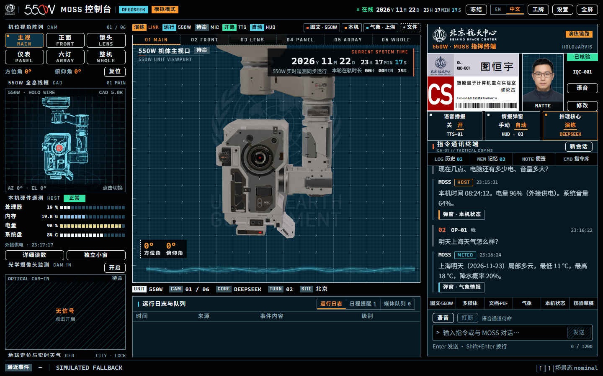
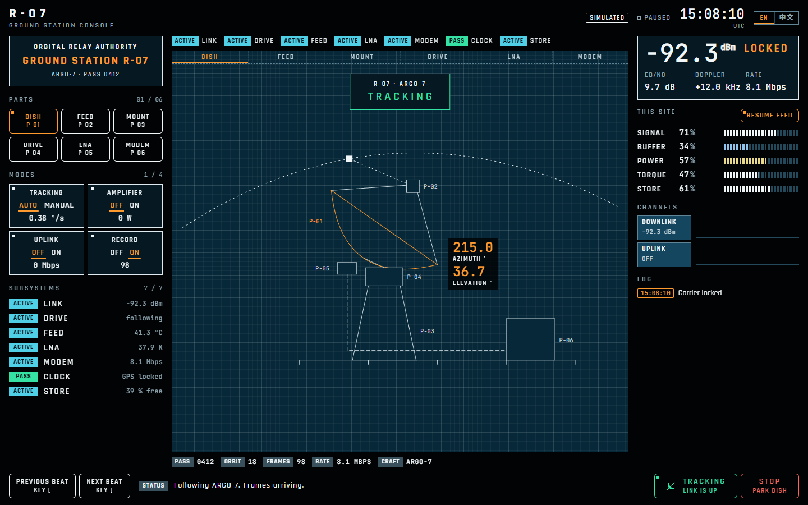

# Wandering Earth FUI Design (Agent Skill & CSS Design System)

[简体中文说明 (README.zh-CN.md)](./README.zh-CN.md) · [Changelog](./CHANGELOG.md) · [License (MIT)](./LICENSE)

> **⚠️ Unofficial Fan Tribute / 非官方声明**  
> This is an **unofficial fan-made tribute** created by a fan of *The Wandering Earth* ("小破球") film series — **not** an official design system and not affiliated with the film's producers or rights holders. Code, tokens, stylesheets, and scripts are openly released under the permissive **MIT License**. **If there is any copyright concern or dispute, please notify us via GitHub Issue and we will remove the affected content immediately.**  
> 本项目为**非官网/非官方设计**，纯粹是**小破球迷致敬《流浪地球》**的开源作品，采用宽松的 MIT 协议尽量完全开放。**如有任何版权纠纷，请通过 Issue 通知下架，将第一时间配合处理。**

---

Film-grade aerospace FUI (Fictional / Futuristic User Interface) translated into a **shippable, accessible, zero-dependency design system and Agent Skill** — compatible with **Claude Code**, **OpenAI Codex**, **Antigravity / Gemini**, **Cursor**, and any `SKILL.md`-compatible coding agent.

**Core principle: every mark is an instrument.** Flat hairline geometry, dark tactical surfaces, one blueprint measurement stage, high-contrast functional aerospace accents, English + Simplified Chinese (`Rajdhani` + `JetBrains Mono` + `Source Han Sans SC`), and automated L1–L3 QA scripts — zero cyberpunk purple-pink slop, zero decorative glow/blur, zero fake telemetry.

---

## Previews

### 1. Live 3D Tactical Command Console Showcase (starter: `assets/tactical.html`)
*Recommended for rich 3D, AI assistant, multimodal, and multi-subsystem consoles: 3-column zero-void frame, 3px semantic vertical header ticks (`data-accent`), Behance split-unit chronometer (`.fui-chrono`), subject-avoiding contextual HUD viewers (`.fui-hud-card`), tactile segmented/matrix pickers, controllable rotating dot-matrix globe + site weather, transparent floating `drawOrbit` voice wave, compact 3-tile mode deck, and always-on `.fui-chat`.*



### 2. Station Console (`assets/station.html`)
*Recommended for minimalist monitoring & switching stations: pure black ground (`--fui-void`), frameless control groups, rounded 6px white `.fui-key` outlines, orange selection (`--fui-act`), mode tiles, chip rows, tag strips, and blueprint schematic stage.*



---

## Quick Installation (Agent Skill)

Install into your preferred coding agent's skills directory:

```bash
# Antigravity / Gemini
git clone https://github.com/langyan1022/wandering-earth-fui-design.git ~/.gemini/config/skills/wandering-earth-fui-design

# Claude Code
git clone https://github.com/langyan1022/wandering-earth-fui-design.git ~/.claude/skills/wandering-earth-fui-design

# OpenAI Codex
git clone https://github.com/langyan1022/wandering-earth-fui-design.git ~/.codex/skills/wandering-earth-fui-design
```

Or via Skills CLI (if installed):

```bash
npx skills add langyan1022/wandering-earth-fui-design
```

Once installed, invoke it naturally in chat (e.g. *"Build this dashboard using the wandering-earth-fui-design skill"* or `/wandering-earth-fui-design`).

---

## What's Included

| Path | Description |
|---|---|
| `SKILL.md` | Agent entrypoint: visual principles, two first-class console compositions, tokens, motion gate, never-do list, and QA checklist |
| `assets/fui.css` | **Compiled 31-module zero-dependency stylesheet** (165 KB) generated from `references/*.md` via `scripts/build_css.py` |
| `assets/tactical.html` | Working **Tactical Command Console** starter (3-column command layout, HUD viewers, chronometer, globe, floating audio, comms) |
| `assets/station.html` | Working **Station Console** starter (shapes on black, orange selection, tag strips, schematic stage) |
| `assets/starter.html` | Working **Monitor / Table Workbench** starter |
| `assets/fui-sim.js` | Deterministic seeded data, pausable feed (`?paused=1`), and storyboard beat driver (`?beat=`, `[` / `]`, optional `immediate: false` + `start()`) |
| `assets/fui-geo.js` | Zero-dependency dot-matrix globe (`drawGlobe`, `flyTo`, `attachGlobeControls`) & flat world map (`drawFlatMap`) |
| `assets/fui-audio.js` | Zero-dependency glowing sine waves (`drawOrbit`), comms envelope (`drawEnvelope`), spectrum (`drawSpectrum`), meter, and radial renderers |
| `assets/encom-globe/` | Optional WebGL globe (MIT, Robert Scanlon) with token-themed adapter (`references/globe-webgl.md`) |
| `assets/logos/` | 57 fan-redrawn SVG emblems (46 static, 11 animated) + `manifest.json` (for personal/tribute demos) |
| `references/` | Full modular specifications: `tokens`, `foundations`, `typography`, `layout`, `devices`, `patterns`, `station`, `hud-viewers`, `scenarios`, `motion-spec`, `i18n`, `geo`, `audio`, `logos`, `workflow`, `qa`, `accessibility`, and `components/*.md` |
| `scripts/` | Zero-dependency tooling: `build_css.py`, `bundle_html.py`, `fui_lint.py` (L1 static linter), `fui_probes.js` & `fui_verify.mjs` (L2/L3 Playwright verification supporting Chromium, Chrome, and Windows Edge) |
| `evals/` | Benchmark scenarios and grading rubrics |

---

## Standalone Tooling & Verification

No npm build pipeline is required to use the stylesheet or run static checks:

```bash
# 1. Serve the bundled starters locally and open in a browser
python3 -m http.server 8080 --directory assets
# Visit http://127.0.0.1:8080/tactical.html  or  /station.html  or  /starter.html

# 2. Bundle any page + fui.css + ES modules into a single self-contained HTML file
python3 scripts/bundle_html.py assets/tactical.html -o dist-tactical.html

# 3. Rebuild assets/fui.css after editing any ```css block in references/
python3 scripts/build_css.py
python3 scripts/build_css.py --check

# 4. Run L1 static lint (zero deps, Python 3 stdlib)
python3 scripts/fui_lint.py path/to/your/app

# 5. Run L2 screenshots + L3 live DOM/contrast/idle probes (Node 18+ & Playwright / Chrome / Edge)
node scripts/fui_verify.mjs assets/tactical.html --langs zh-CN,en --beats nominal,speaking,degraded,critical
```

---

## License & Credits

- **License**: [MIT License](./LICENSE) — maximally open for personal, educational, and commercial software projects.
- **Visual Study Inspiration**: Richard Chan's *The Wandering Earth FUI design* (Behance, 2020).
- **ENCOM Globe**: Robert Scanlon (MIT License, see `assets/encom-globe/LICENSE.txt`).
- **Tribute Notice**: Unofficial fan tribute to *The Wandering Earth* ("小破球"). Please replace in-universe fan marks in `assets/logos/` with your own brand assets for commercial products, and contact us immediately via GitHub Issue for any copyright takedown request.
