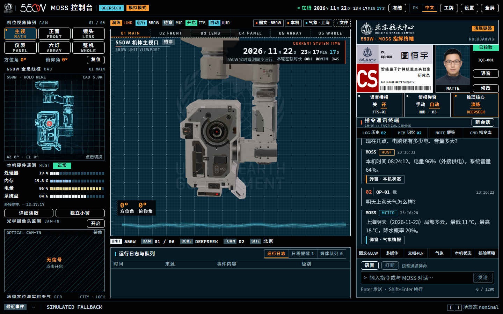
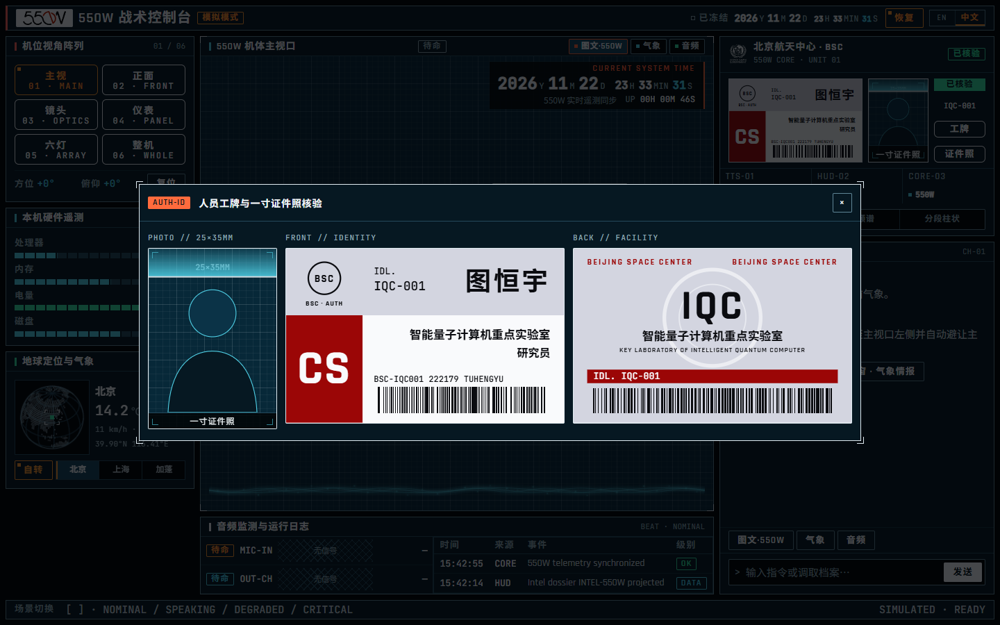
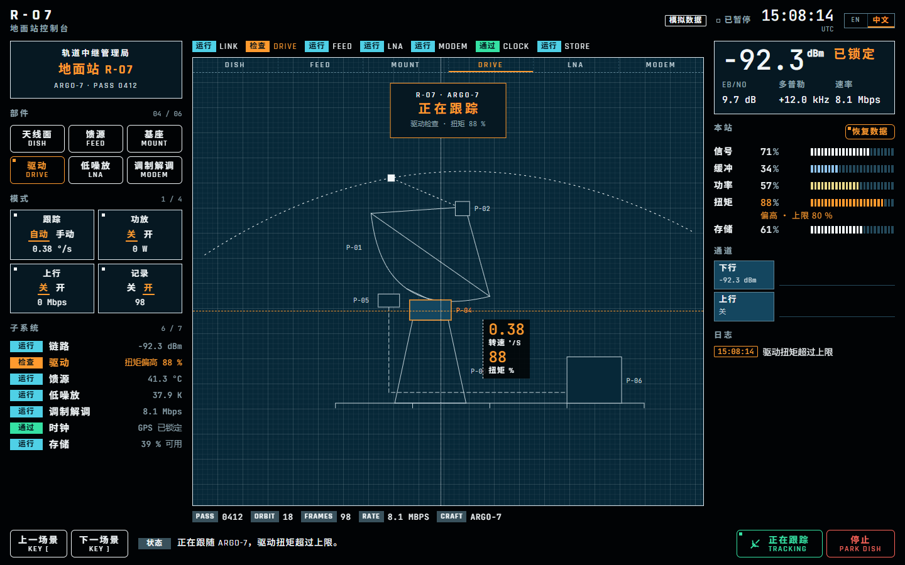

# 流浪地球风格 FUI 设计系统与 Agent 技能（Wandering Earth FUI Design）

[English README](./README.md) · [更新日志 (CHANGELOG)](./CHANGELOG.md) · [开源协议 (MIT)](./LICENSE)

> **⚠️ 重要声明（非官方设计 · 球迷致敬）**  
> 本项目为**非官网 / 非官方设计**，纯粹是**小破球迷致敬《流浪地球》系列电影**的开源设计规范与 AI Agent 技能整理作品，与电影出品方、制作方及版权方无任何官方关联。  
> 仓库中的设计规范、CSS 样式、脚本与工具链全部采用尽量完全开放的 **MIT 开源协议**。仓库内用于演示与学习的致敬性矢量标识（`assets/logos/`）仅作个人学习与致敬参考，**如有任何版权纠纷，请通过 GitHub Issue 通知下架，作者将在收到后第一时间配合删除或调整**。

---

将电影级航天硬核 FUI（Fictional / Futuristic User Interface）转化为**真正可上线、可读、零依赖的工程级设计系统与 Agent Skill**，原生支持 **Antigravity / Gemini**、**Claude Code**、**OpenAI Codex**、**Cursor** 等各类支持 `SKILL.md` 的 AI 编程工具。

**核心原则：屏幕上的每一笔都是真实仪表。** 纯黑暗底、1px 细线结构、单一蓝图测量主视口、克制的航天工业语义撞色、原生中英双语（`Rajdhani` + `JetBrains Mono` + `思源黑体`）、配套 L1–L3 自动化验证脚本——拒绝赛博紫粉霓虹、拒绝模糊投影和假数据装饰。

---

## 实机预览

### 1. 实机 3D 战术指挥控制台展示（零依赖模板：`assets/tactical.html`）
*推荐用于 3D 孪生、AI 助手、多模态与多子系统控制台：零空洞三栏结构、3px 面板语义竖标（`data-accent`）、Behance 原片同款分单位纪元时钟（`.fui-chrono`）、自动避让主体的上下文 HUD 浮窗查看器（`.fui-hud-card`）、触感矩阵/分段选择器（替代丑陋原生 `<select>`）、可控慢速自转点阵地球仪 + 实时气象、透明悬浮流光声纹（`drawOrbit`）、双面矢量工牌与一寸抠图证件照（`.fui-badge-card` / `.fui-id-photo`）、紧致三瓦片模式板与常驻 `.fui-chat` 指令通讯终端。*



### 2. 双面人员工牌与一寸抠图证件照组件（`references/components/credential.md` + `assets/fui-credential.js`）
*零依赖开箱即用：450:282 双面矢量工牌（内置真实可扫码 ISO/IEC 15417 Code-128B 矢量条形码）与标准一寸（25×35mm）蓝图证件照（默认安全矢量轮廓、支持用户上传照片离线 Canvas 抠图与自上而下激光扫描同步揭示，也可对接本地神经网络抠图回调）。*



### 3. 空间站极简控制台（`assets/station.html`）
*推荐用于精简监控与切换类控制台：纯黑底面直接排布无框分组、6px 圆角白边按键（`.fui-key`）、电影橙色选中态（`--fui-act`）、模式瓦片、状态芯片行、上下标签条与蓝图结构图视口。*



---

## 快速安装为 Agent Skill

直接克隆到对应工具的技能目录即可生效：

```bash
# Antigravity / Gemini
git clone https://github.com/langyan1022/wandering-earth-fui-design.git ~/.gemini/config/skills/wandering-earth-fui-design

# Claude Code
git clone https://github.com/langyan1022/wandering-earth-fui-design.git ~/.claude/skills/wandering-earth-fui-design

# OpenAI Codex
git clone https://github.com/langyan1022/wandering-earth-fui-design.git ~/.codex/skills/wandering-earth-fui-design
```

或使用 Skills CLI 安装：

```bash
npx skills add langyan1022/wandering-earth-fui-design
```

安装完成后，在对话中直接要求 *"使用 wandering-earth-fui-design 技能构建/重构这个控制台界面"* 即可触发完整设计工作流与验证门禁。

---

## 仓库内容总览

| 路径 | 说明 |
|---|---|
| `SKILL.md` | Agent 技能主入口：视觉原则、两大一级控制台范式（战术指挥台 & 空间站台）、设计 Token、动效门禁与验收清单 |
| `assets/fui.css` | **32 模块零依赖预编译完整样式表**，由 `scripts/build_css.py` 从 `references/*.md` 自动汇总生成 |
| `assets/tactical.html` | 开箱即用的**战术指挥控制台**模板（三栏语义竖标、纪元时钟、避让式 HUD 浮窗、点阵地球仪、流光声纹、双面工牌与一寸证件照、常驻对话） |
| `assets/station.html` | 开箱即用的**空间站极简控制台**模板（黑底无框、圆角白键、电影橙选中、上下标签条） |
| `assets/starter.html` | 开箱即用的**表格/监控工作台**模板 |
| `assets/fui-sim.js` | 确定性随机种子、可暂停数据流（`?paused=1`）与故事板场景驱动器（支持 `?beat=`、`[`/`]` 键以及多模块延迟启动 `immediate: false` + `start()`） |
| `assets/fui-credential.js` | 零依赖**双面矢量工牌（450:282）**、真实 **ISO/IEC 15417 Code-128B** 矢量条形码、**标准一寸（25×35mm）抠图证件照**（蓝图轮廓默认态 + 自上而下激光扫描揭示 + 离线 Canvas 抠图） |
| `assets/fui-geo.js` | 零依赖点阵地球仪（`drawGlobe`、`flyTo`、拖拽与键控）与平面点阵世界地图（`drawFlatMap`） |
| `assets/fui-audio.js` | 零依赖流光正弦声纹（`drawOrbit`）、通讯包络波形（`drawEnvelope`）、频谱（`drawSpectrum`）、电平表与径向频谱 |
| `assets/encom-globe/` | 可选 3D WebGL 地球组件（Robert Scanlon，MIT 协议），附 FUI Token 适配层 |
| `assets/logos/` | 57 枚球迷重绘致敬 SVG 标识（46 静态 + 11 动效）与 `manifest.json`（仅用于个人学习与致敬展示） |
| `references/` | 全套模块化设计文档：Token、排版、布局、设备档位（大屏/车载/穿戴/透视 HUD）、上下文 HUD 查看器（`hud-viewers.md`）、动效、多语言、旁路反代重制、QA 与各组件细则 |
| `scripts/` | 零依赖工具链：`build_css.py`、`bundle_html.py`（单文件打包）、`fui_lint.py`（L1 静态检查）、`fui_probes.js` 与 `fui_verify.mjs`（支持 Chromium / Chrome / Windows Edge 的 L2 截图 + L3 探针脚本） |
| `evals/` | 技能评测用例与评分标准 |

---

## 本地运行与自动化验证

无需任何前端构建工具即可预览模板和运行校验：

```bash
# 1. 本地预览三套开箱即用模板
python3 -m http.server 8080 --directory assets
# 浏览器打开 http://127.0.0.1:8080/tactical.html 或 /station.html 或 /starter.html

# 2. 将页面、fui.css 与 ES 模块内联打包为单个可双击打开的 HTML
python3 scripts/bundle_html.py assets/tactical.html -o dist-tactical.html

# 3. 修改 references/*.md 中的 CSS 后重新编译并核验 assets/fui.css
python3 scripts/build_css.py
python3 scripts/build_css.py --check

# 4. 运行 L1 静态规范检查（仅依赖 Python 3 标准库）
python3 scripts/fui_lint.py 你的项目目录

# 5. 运行 L2 多分辨率双语截图 + L3 运行时探针（支持 Chromium / Chrome / Windows Edge）
node scripts/fui_verify.mjs assets/tactical.html --langs zh-CN,en --beats nominal,speaking,degraded,critical
```

---

## 开源协议与鸣谢

- **开源协议**：采用 [MIT License](./LICENSE)，尽量保持最大程度开放，欢迎自由学习、修改、二次开发与分发。
- **视觉研究致敬**：参考了 Richard Chan 于 2020 年在 Behance 发布的《The Wandering Earth FUI design》非商业研究作品。
- **第三方组件**：`assets/encom-globe/` 来自 Robert Scanlon 的 ENCOM Globe（MIT License）。
- **再次声明**：本项目为小破球迷个人非官方致敬作品，商业项目请将 `assets/logos/` 替换为你自己的品牌标识；**如有任何版权异议，请随时通过 GitHub Issue 告知，本人将第一时间配合下架处理。**
